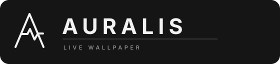

# Auralis

<picture>
  <source media="(prefers-color-scheme: dark)" srcset="assets/auralis-logo-dark.svg">
  
</picture>

A Rust-first live wallpaper application for **Windows** and **macOS**, built around native video playback and a quiet monochrome desktop experience.

## Features (`v0.2.0-beta.1`)

- **Native Video Wallpapers**: Windows uses Media Foundation (`mfplay.dll` / `IMFPMediaPlayer`) and `Progman`/`WorkerW` desktop layering. macOS uses AVFoundation (`AVPlayer` / `AVPlayerLayer`) and an AppKit desktop host. The macOS native integration compiles in CI; desktop layering and playback still need interactive acceptance testing on supported Macs.
- **Memory-conscious playback flow**: Auralis stops its preview decoder before applying a wallpaper, avoiding two simultaneous video decoders. Playback keeps the source resolution and uses the platform video path; resource use depends on the selected video and hardware. The Studio reports process Working Set and Private Bytes separately, since trimming resident pages does not reduce committed private memory.
- **Live Playback Speed, Aspect Scaling & Recent Wallpapers**: Adjust playback speed (`0.25x` – `2.00x`), toggle aspect scaling between **Fill (Full Screen)** and **Fit (Letterbox)**, and cycle through up to 10 recent wallpapers from the Studio UI or System Tray menu.
- **Windows Configuration Studio**: Launch `auralis.exe` (or `cargo run`) for an embedded video preview, drag-and-drop file loading, display selection, playback/audio/loop/speed/scale controls, and live process telemetry. Its grayscale live indicator honors the saved Reduce Motion setting and Windows animation accessibility preference.
- **Windows System Tray & Login Startup Integration**: Minimizes to the Windows System Tray (`Shell_NotifyIconW`) with the custom A/wave icon and quick-control menu (`Open`, `Next Recent Wallpaper`, `Pause / Resume`, `Mute / Unmute`, `Stop`, `Quit`) and optional login startup registration.
- **macOS Menu Bar and Studio**: Runs as a menu-bar app with a matching monochrome mark. **Open Auralis Studio…** (Cmd-,) opens a native AppKit window with display selection, a video path field with Browse, drag and drop and Next recent, an on-demand preview, Set as wallpaper, pause/resume, stop, mute, loop, volume, speed, Fill/Fit scaling, the behavior settings, and live status. The Studio opens automatically when no wallpaper is running; closing it keeps the wallpaper playing. The menu also offers the file picker, recent cycling, pause/resume, mute, stop, and Launch at Login, and Auralis handles display changes and sleep/wake.
- **Resilient Runtime**: Closing or minimizing the configuration window keeps your live wallpaper playing in the background. Failed media replacements automatically preserve your previous working wallpaper, and corrupt config files are safely backed up to `.corrupt.bak`.
- **Smart Power, Sleep/Wake & Full-Screen Policies**: Automatically pauses video playback when a full-screen application/game occludes the monitor, when the system enters sleep (`WM_POWERBROADCAST`), or when running on battery power.

## Platform support

| Platform | Current support |
| --- | --- |
| Windows x64 | Native Studio UI, desktop wallpaper layering, hardware video playback, tray controls, and startup integration are implemented. CI builds and tests on Windows; desktop layering and playback still need manual acceptance testing on each supported Windows configuration. |
| macOS | Native menu-bar app and Studio window, AVFoundation video playback, multi-display host creation, LaunchAgent control, full-screen and battery pause, and sleep/wake/display-change handling are implemented. CI compiles and tests the native bridge. The first real-Mac report found the wallpaper was not visible; a fix is in place but has not been retested on a Mac yet, and the Studio window is untested on a real Mac. |

For engineering and contribution guidance, see [AGENTS.md](AGENTS.md), [CONTRIBUTING.md](CONTRIBUTING.md), and [docs/PLATFORM_TEST_MATRIX.md](docs/PLATFORM_TEST_MATRIX.md). Brand rules, the mark geometry, and how the icons and installer art are generated are in [docs/BRAND.md](docs/BRAND.md); design and resource measurement notes are in [docs/UX_AND_PERFORMANCE.md](docs/UX_AND_PERFORMANCE.md).

## Usage & CLI Commands

```powershell
# Launch the Auralis desktop app (Windows Studio or macOS menu bar app)
cargo run --release
# Launch the Windows Studio minimized to the system tray:
.\target\release\auralis.exe gui --minimized

# Play a live video wallpaper behind desktop icons for N seconds from the CLI
.\target\release\auralis.exe play path\to\video.mp4 15

# Configure a wallpaper for a display (a running Windows Studio session reloads it live)
.\target\release\auralis.exe apply path\to\video.mp4 [DISPLAY1]

# Inspect platform capabilities, power status, measured Working Set/Private RAM, and connected displays
.\target\release\auralis.exe status

# Validate a video file for wallpaper compatibility
.\target\release\auralis.exe validate path\to\video.mp4

# Verify native wallpaper host creation and cleanup (not visual layering)
.\target\release\auralis.exe verify-desktop

# Quit a running Studio and restore the desktop (exits 0 if none is running; used by installers)
.\target\release\auralis.exe quit
```

## Quality Gates & Local Verification

Before submitting changes or pushing, all 5 local quality gates must pass:

```powershell
# Windows PowerShell
powershell -ExecutionPolicy Bypass -File scripts/verify.ps1
```

```bash
# macOS / Linux Shell
bash scripts/verify.sh
```

These scripts verify:
1. Formatting: `cargo fmt --all -- --check`
2. Static Analysis: `cargo clippy --workspace --all-targets --all-features --locked -- -D warnings`
3. Test Suite: `cargo test --workspace --all-features --locked`
4. Release Compilation: `cargo build --workspace --release --all-features --locked`
5. Patch Hygiene: `git diff --check`

## CI/CD and release artifacts

Every merge to `main` is built on native Windows and macOS runners and published as a numbered **prerelease** on the [Releases page](https://github.com/somyacodes07/Auralis/releases), tagged like `v0.2.0-beta.1+build.42`. The build number is shown in the Studio title bar and in `auralis status`. These are unsigned test builds; see [docs/CI_CD_SETUP.md](docs/CI_CD_SETUP.md).

### Install on Windows

1. Download `auralis-<version>-windows-x86_64-setup.exe` from the release (Windows 10 or 11, x64). This is the recommended option.
2. Run it. It installs for your account only, into `%LOCALAPPDATA%\Programs\Auralis`, and does not ask for administrator rights. You can add a desktop shortcut and choose **Start Auralis when I sign in**.
3. The installer is not code-signed yet, so Microsoft Defender SmartScreen may show "Windows protected your PC". Choose **More info**, then **Run anyway**.
4. To remove it, open **Settings, Apps, Installed apps**, find **Auralis**, and choose **Uninstall** (or right-click Auralis in the Start menu and choose **Uninstall**). The uninstaller closes a running Auralis and removes the sign-in entry. It asks whether to also delete your settings and logs; the default keeps them. Your video files are never touched.

Prefer not to install? Download `auralis-<version>-windows-x86_64.zip` instead, unzip it anywhere, and run `auralis.exe`. To remove the portable copy, quit Auralis, turn off **Launch at startup** if you enabled it, and delete the folder.

### Install on macOS

1. Download `auralis-<version>-macos-universal.dmg` from the release (works on Apple Silicon and Intel Macs, macOS 13 or later).
2. Open the DMG and drag **Auralis** onto **Applications**.
3. The app is not notarized yet. The first time, Control-click **Auralis** in Applications, choose **Open**, then **Open** again. If macOS still blocks it, go to **System Settings, Privacy & Security** and choose **Open Anyway**.
4. Auralis runs in the menu bar. The Studio window opens on first launch and from **Open Auralis Studio…** in the menu bar; a Dock icon shows only while the Studio is open. To remove Auralis, quit it from the menu bar and move `Auralis.app` to the Trash.


Pull requests to `main` run formatting, patch-hygiene, and `cargo deny` supply-chain checks plus native Windows and macOS Clippy, tests, and release builds. Releases are tag-driven via [`.github/workflows/release.yml`](.github/workflows/release.yml). The workflow checks SemVer, exact equality with `Cargo.toml`, and reachability from the default branch. It builds a Windows installer, a portable Windows ZIP, and a universal macOS DMG. The draft release remains unsigned and must be reviewed and manually published after native acceptance testing:

1. Push the committed source to the default branch, then push its matching annotated SemVer tag (e.g., `v0.2.0-beta.1`):
   ```powershell
   git push -u origin main
   git tag -a v0.2.0-beta.1 -m "Auralis v0.2.0-beta.1 Beta Release"
   git push origin v0.2.0-beta.1
   ```
2. GitHub Actions creates a **draft** release with Windows and macOS artifacts plus SHA-256 checksums. The macOS DMG holds a universal, ad-hoc signed app that is not notarized. Review and publish the draft manually only after platform acceptance testing.

## Troubleshooting

The desktop app (`auralis` / `auralis gui`) and `auralis play` keep a diagnostics log. `auralis status` prints its location:

- Windows: `%LOCALAPPDATA%\Auralis\logs\auralis.log`
- macOS: `~/Library/Logs/Auralis/auralis.log`

Each line has a UTC timestamp, a level, and a message. The log records startup, wallpaper apply and restore failures, playback errors, configuration recovery, and crashes (panic message and source location). It keeps about 1 MB, moving older entries to `auralis.log.1`. Media files are logged by file name only, never by full path. Attach the log when you report a bug; read it first if you prefer not to share a file name.

## Windows executable resources

On Windows, `build.rs` embeds the icon in [assets/auralis.ico](assets/auralis.ico) and version information (product name, description, version, copyright) into `auralis.exe`, using `rc.exe` from the Windows SDK for MSVC builds or `windres` for GNU builds. Set `RC` or `WINDRES` to choose a specific tool. If none is found, the build still succeeds with a warning and the executable has no icon or version information; CI fails in that case through [scripts/check-exe-resources.ps1](scripts/check-exe-resources.ps1). GNU builds need a `windres` that can produce 64-bit objects, such as `x86_64-w64-mingw32-windres` from MSYS2. The icon and all other brand assets are generated by [scripts/generate_brand_assets.py](scripts/generate_brand_assets.py); see [docs/BRAND.md](docs/BRAND.md).

## License

Auralis is dual-licensed under [MIT](LICENSE-MIT) or [Apache-2.0](LICENSE-APACHE), at your option. See [THIRD_PARTY_LICENSES.md](THIRD_PARTY_LICENSES.md) for the locked dependency license inventory.
