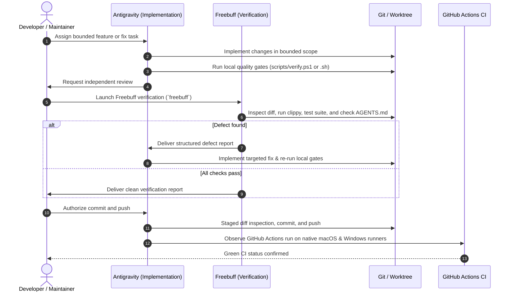

# Auralis — Multi-Agent Engineering Workflow

This document establishes the official engineering workflow for **Auralis**, defining how **Antigravity** (primary implementation agent) and **Freebuff** (independent verification agent) collaborate safely without code conflicts or unauthorized divergence.

All agents operating in this repository must adhere to [`AGENTS.md`](../AGENTS.md) as the primary repository policy, with Freebuff automatically ingesting [`knowledge.md`](../knowledge.md).

---

## 1. Agent Roles & Responsibilities

| Dimension | Antigravity (Implementation Agent) | Freebuff (Verification Agent) |
| :--- | :--- | :--- |
| **Primary Mission** | Design, build, refine, and maintain working application code | Independently inspect, test, review, and audit changes |
| **Working Mode** | Implementation & integration mode | Review-and-test mode (guided by [`knowledge.md`](../knowledge.md)) |
| **Architecture** | Owns product architecture and Rust module boundaries | Flags boundary violations, coupling, or unnecessary crates |
| **Native Integration** | Implements macOS (AVFoundation) & Windows (Media Foundation) bridges | Validates desktop layering safety, memory leaks, and OS hooks |
| **UI/UX Polish** | Builds configuration UI and playback controls | Reviews accessibility, state synchronization, and ergonomics |
| **Quality Gates** | Runs local checks before handoff | Runs independent checks (`fmt`, `clippy`, `tests`, `hygiene`) |
| **Defect Handling** | Implements and verifies fixes | Reports defects using standardized report schema |
| **Version & Release** | Proposes version bumps; prepares release artifacts | Verifies tag/manifest alignment and changelog integrity |
| **Git Operations** | Commits and pushes to `feature/*` and `main` upon gate passage | Reviews diffs; operates in dedicated branch for large fixes |

---

## 2. Preventing Working Tree Conflicts

To prevent simultaneous modifications, racing edits, or uncoordinated refactors:

1. **Single-Agent Working Tree Ownership**: Never allow Antigravity and Freebuff to edit the same working tree simultaneously.
2. **Review-First Stance**: Freebuff is instructed via [`knowledge.md`](../knowledge.md) to operate strictly in review-and-test mode unless explicitly assigned an isolated branch task.
3. **Dedicated Worktree for Substantial Freebuff Fixes**: If Freebuff is explicitly instructed to implement a fix, it must work in an isolated Git worktree or branch (`review/<task-name>` or `fix/<task-name>`), never on the active working tree or branch being edited by Antigravity.
4. **Clean Handoff**: Antigravity completes a bounded task and verifies local gates before Freebuff begins review.

---

## 3. The 10-Step Development & Verification Lifecycle



### Detailed Protocol Steps

1. **Bounded Implementation (Antigravity)**: Antigravity implements the requested task adhering to non-negotiable engineering principles (zero fake functionality, data protection, resilient UI).
2. **Local Pre-Handoff Checks (Antigravity)**: Antigravity runs `powershell -ExecutionPolicy Bypass -File scripts/verify.ps1` (or `bash scripts/verify.sh`).
3. **Self-Review of Git Diff (Antigravity)**: Antigravity runs `git diff` to ensure no stray debug logs, secrets, or unrelated changes are present.
4. **Independent Review (Freebuff)**: Freebuff inspects the diff and checks for architecture compliance against `AGENTS.md`.
5. **Independent Testing (Freebuff)**: Freebuff executes the test suite, linter, and static analysis tools.
6. **Defect Remediation (Antigravity)**: If defects are flagged, Antigravity implements the fix and updates tests.
7. **Reconciliation & Diff Audit**: Maintainer or agents verify the integrated diff is minimal and cohesive.
8. **Final Local Gate Execution**: The complete verification suite is re-run (`scripts/verify.ps1` / `scripts/verify.sh`).
9. **Authorized Commit & Push**: Changes are committed with a clear commit message and pushed to the destination branch.
10. **Post-Push CI Observation**: The pushed commit is monitored in GitHub Actions to verify passing status on native macOS and Windows runners.

---

## 4. Freebuff Defect Reporting Standard

When Freebuff identifies a defect, regression, or compliance failure, it must report it using the following format:

```markdown
### [DEFECT-ID] Concise Summary of Defect

- **Location**: `path/to/file.rs#L12-L34`
- **Severity**: Critical | Major | Minor | Style
- **Problem**: Description of the actual issue found.
- **Why It Matters**: Impact on desktop layering, stability, safety, or user data.
- **Steps to Reproduce**: Exact steps or command reproducing the failure.
- **Proposed Fix**: Conceptual resolution or code snippet.
- **Verification Test**: A unit or integration test verifying the fix.
```

---

## 5. Local Verification Quality Gates

Both agents and developers use canonical verification scripts:

- **Windows (PowerShell)**:
  ```powershell
  powershell -ExecutionPolicy Bypass -File scripts/verify.ps1
  ```
- **macOS / Linux (Bash)**:
  ```bash
  bash scripts/verify.sh
  ```

### Individual Quality Commands

| Gate | Command | Description |
| :--- | :--- | :--- |
| **Formatting** | `cargo fmt --all -- --check` | Enforces standard Rust formatting |
| **Clippy** | `cargo clippy --workspace --all-targets -- -D warnings` | Catches common mistakes and anti-patterns |
| **Tests** | `cargo test --workspace` | Runs all unit and integration tests |
| **Release Build**| `cargo build --workspace --release` | Validates release profile compilation |
| **Patch Hygiene**| `git diff --check` | Detects whitespace errors and conflict markers |

---

## 6. Freebuff Invocation & Handoff Procedures

Freebuff (`freebuff` v0.0.155) is installed in the development environment and automatically reads [`knowledge.md`](../knowledge.md) and [`AGENTS.md`](../AGENTS.md) when launched in the repository root.

### Interactive Terminal Verification
1. Open a terminal in `c:\Users\Somyajeet\Code\Git\Auralis` and launch Freebuff:
   ```powershell
   freebuff
   ```
   *(Or resume a previous verification session via `freebuff --continue`)*
2. Enter the verification prompt:
   > "Review the latest Git commits and working tree against AGENTS.md and knowledge.md. Run `powershell -ExecutionPolicy Bypass -File scripts/verify.ps1`, audit module boundaries and unsafe blocks, and provide a structured verification report."
3. Share any reported defects with Antigravity for targeted remediation.

---

## 7. Branch, Merge, and CI/CD Policy

### Branch Strategy
- `main`: Protected production branch.
- `feature/*`: Bounded feature development.
- `fix/*`: Targeted bug fixes.
- `review/*`: Isolated review or audit worktrees.

### Branch Protection Requirements (GitHub Settings)
The repository owner must configure the following rules for `main`:
1. Require pull request before merging.
2. Require status checks to pass before merging:
   - `Windows Native Verification`
   - `macOS Native Verification`
   - `Code Formatting`
   - `Patch & Workspace Hygiene`
3. Require branches to be up to date before merging.
4. Block force pushes (`git push --force`).
5. Block branch deletion.

---

## 8. Versioning & Release Discipline

1. **Semantic Versioning**: Follow `MAJOR.MINOR.PATCH` with `0.x.y` for early development.
2. **Single Source of Truth**: `Cargo.toml` `[package].version`.
3. **No Automatic Bumps**: Version changes require explicit milestone justification and maintainer approval.
4. **Release Gate**: Releases trigger exclusively on annotated git tags (e.g. `v0.1.0-alpha.1` or `v0.1.0`). The release workflow validates that the tag matches `Cargo.toml` before building artifacts on native macOS and Windows runners.
